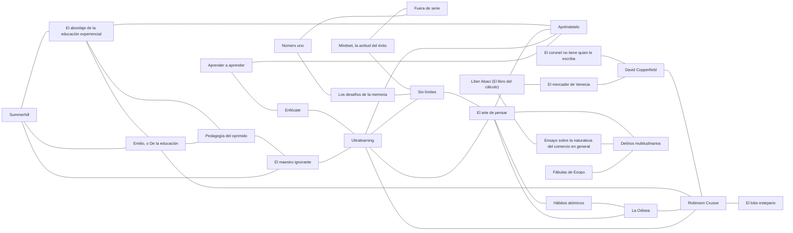

# Biblioteca

Libros que iluminan el currículo: novelas, fábulas, obras de teatro, tratados y divulgación. Cada libro tiene una **ficha** (`<slug>.md`) que dice de qué trata, qué temas toca, con qué otros libros se cruza y con qué nodos del currículo se conecta.

La biblioteca no reemplaza a los nodos: es la puerta para quien quiere ir más allá, y una fuente de ganchos e historias para quien escribe un nodo.

## Cómo agregar un libro

1. Copia `docs/plantillas/libro.md` a `biblioteca/<slug>.md`. El slug va en minúsculas y con guiones, sin artículos al inicio si no hacen falta.
2. Usa solo temas de [`_temas.yaml`](_temas.yaml). Si falta uno, agrégalo en el mismo PR.
3. En `cruza_con`, escribe **por qué** se cruzan los dos libros, en una frase. Cada cruce se declara una sola vez, en cualquiera de los dos libros; el índice lo muestra en ambos sentidos.
4. En `nodos`, pon solo ids que existan en algún `_modulo.yaml`.
5. Un libro nuevo entra con `estado: propuesta`. Pasa a `aceptado` cuando un curador lo revisa.
6. Corre `python3 scripts/biblioteca.py --indice` para validar y actualizar el índice de abajo.

## Reglas

- **Derechos de autor.** Si el libro tiene derechos (`acceso: con-derechos`), no se suben copias ni fragmentos largos. Se cuenta con palabras propias y se citan frases cortas. Solo los libros de dominio público llevan `texto_libre`, y el enlace debe ser a una edición legal (Gutenberg, Wikisource).
- **No inventes datos** (AGENTS.md, regla 5). Fechas, capítulos y escenas se comprueban; si no hay fuente, se deja `<!-- VERIFICAR: ... -->`.
- **Con cuidado.** Si el libro trae temas sensibles o prejuicios de su época, la ficha lo dice.

<!-- indice:inicio -->
<!-- Generado por scripts/biblioteca.py --indice. No editar a mano. -->

### Libros

| Libro | Autor | Publicado | Temas | Nodos | Estado |
| --- | --- | --- | --- | --- | --- |
| [*Aprender a aprender*](learning-how-to-learn.md) | Barbara Oakley y Terrence Sejnowski, con Alistair McConville | 2018 | aprender-a-aprender, concentracion, memoria | — | propuesta |
| [*Apréndetelo*](make-it-stick.md) | Peter C. Brown, Henry L. Roediger III y Mark A. McDaniel | 2014 | aprender-a-aprender, memoria | — | propuesta |
| [*David Copperfield*](david-copperfield.md) 📖 | Charles Dickens | 1849-1850 | presupuesto, deuda, dignidad | `dinero.ingresos-y-gastos`, `dinero.presupuesto` | propuesta |
| [*Delirios multitudinarios*](delirios-multitudinarios.md) 📖 | Charles Mackay | 1841 | especulacion, codicia | `dinero.estafas-y-piramides`, `dinero.invertir-lo-basico`, `dinero.inflacion` | propuesta |
| [*El abordaje de la educación experiencial*](el-abordaje-de-la-educacion-experiencial.md) | Juan Felipe Builes Jaramillo | 2003 | educacion, aprender-a-aprender | — | propuesta |
| [*El arte de pensar*](el-arte-de-pensar.md) | Rolf Dobelli | 2011 | sesgos, especulacion, autocontrol, aprender-a-aprender | `dinero.estafas-y-piramides`, `dinero.interes-compuesto`, `dinero.ahorro-y-metas`, `dinero.invertir-lo-basico`, `dinero.costo-real-de-un-credito` | propuesta |
| [*El coronel no tiene quien le escriba*](el-coronel-no-tiene-quien-le-escriba.md) | Gabriel García Márquez | 1961 | vejez-y-proteccion, dignidad | `dinero.primer-salario-y-seguridad-social` | propuesta |
| [*El lobo estepario*](el-lobo-estepario.md) | Hermann Hesse | 1927 | identidad, soledad | — | propuesta |
| [*El maestro ignorante*](el-maestro-ignorante.md) | Jacques Rancière | 1987 | educacion, aprender-a-aprender | — | propuesta |
| [*El mercader de Venecia*](mercader-de-venecia.md) 📖 | William Shakespeare | hacia 1596-1598 | deuda, justicia, comercio | `dinero.deuda-buena-y-mala`, `dinero.costo-real-de-un-credito` | propuesta |
| [*Emilio, o De la educación*](emilio.md) 📖 | Jean-Jacques Rousseau | 1762 | educacion, aprender-a-aprender | — | propuesta |
| [*Enfócate*](deep-work.md) | Cal Newport | 2016 | concentracion, aprender-a-aprender | — | propuesta |
| [*Ensayo sobre la naturaleza del comercio en general*](ensayo-sobre-el-comercio.md) 📖 | Richard Cantillon | 1755 | emprendimiento, comercio, especulacion | `dinero.emprender-con-numeros`, `dinero.inflacion` | propuesta |
| [*Fuera de serie*](outliers.md) | Malcolm Gladwell | 2008 | talento-y-practica, aprender-a-aprender | — | propuesta |
| [*Fábulas de Esopo*](fabulas-de-esopo.md) 📖 | Esopo (atribuidas) | s. VI a. C. (según la tradición) | ahorro, codicia | `dinero.ahorro-y-metas`, `dinero.invertir-lo-basico` | propuesta |
| [*Hábitos atómicos*](atomic-habits.md) | James Clear | 2018 | habitos, autocontrol, ahorro, aprender-a-aprender | `dinero.ahorro-y-metas`, `dinero.interes-compuesto` | propuesta |
| [*La Odisea*](odisea.md) 📖 | Homero | s. VIII a. C. (según la tradición) | viaje, autocontrol | `dinero.ahorro-y-metas` | propuesta |
| [*Liber Abaci (El libro del cálculo)*](liber-abaci.md) | Leonardo de Pisa (Fibonacci) | 1202 | matematicas, comercio | `dinero.costo-real-de-un-credito` | propuesta |
| [*Los desafíos de la memoria*](moonwalking-with-einstein.md) | Joshua Foer | 2011 | memoria, talento-y-practica, aprender-a-aprender | — | propuesta |
| [*Mindset, la actitud del éxito*](mindset.md) | Carol S. Dweck | 2006 | talento-y-practica, aprender-a-aprender, identidad | — | propuesta |
| [*Número uno*](peak.md) | Anders Ericsson y Robert Pool | 2016 | talento-y-practica, aprender-a-aprender | — | propuesta |
| [*Pedagogía del oprimido*](pedagogia-del-oprimido.md) | Paulo Freire | 1970 | educacion, justicia, aprender-a-aprender | — | propuesta |
| [*Robinson Crusoe*](robinson-crusoe.md) 📖 | Daniel Defoe | 1719 | necesidad-y-deseo, presupuesto, soledad, viaje | `dinero.necesidad-o-deseo`, `dinero.presupuesto` | propuesta |
| [*Sin límites*](limitless.md) | Jim Kwik | 2020 | aprender-a-aprender, sesgos | — | propuesta |
| [*Summerhill*](summerhill.md) | A. S. Neill | 1960 | educacion, aprender-a-aprender | — | propuesta |
| [*Ultralearning*](ultralearning.md) | Scott H. Young | 2019 | aprender-a-aprender, autocontrol | — | propuesta |

📖 = texto completo libre y legal (dominio público).

### Cruces

| Libro | Se cruza con | Por qué |
| --- | --- | --- |
| [*Aprender a aprender*](learning-how-to-learn.md) | [*Enfócate*](deep-work.md) | Dos maneras de concentrarse: bloques cortos de 25 minutos con descanso (Oakley) o bloques largos sin distracciones (Newport). |
| [*Apréndetelo*](make-it-stick.md) | [*Aprender a aprender*](learning-how-to-learn.md) | Las mismas ideas sobre cómo se aprende: una versión para adultos y otra para niños y adolescentes. |
| [*Apréndetelo*](make-it-stick.md) | [*Ultralearning*](ultralearning.md) | Apréndetelo es la ciencia detrás de dos principios de Ultralearning: recuperar y retener. |
| [*David Copperfield*](david-copperfield.md) | [*Robinson Crusoe*](robinson-crusoe.md) | Dos maneras de llevar cuentas: la regla de Micawber y la lista de males y bienes de Robinson. |
| [*El abordaje de la educación experiencial*](el-abordaje-de-la-educacion-experiencial.md) | [*Apréndetelo*](make-it-stick.md) | Coinciden en que vivir algo no basta para aprenderlo: hace falta reflexionar (Builes) o recuperar de memoria (Apréndetelo). |
| [*El abordaje de la educación experiencial*](el-abordaje-de-la-educacion-experiencial.md) | [*Emilio, o De la educación*](emilio.md) | Rousseau aparece entre las bases filosóficas de la educación experiencial: aprender de las cosas y no de los discursos. |
| [*El abordaje de la educación experiencial*](el-abordaje-de-la-educacion-experiencial.md) | [*Pedagogía del oprimido*](pedagogia-del-oprimido.md) | Los dos parten de John Dewey: Freire lo lleva a la alfabetización de adultos y la justicia social; Builes, a los talleres de aventura en grupo. |
| [*El arte de pensar*](el-arte-de-pensar.md) | [*Apréndetelo*](make-it-stick.md) | El exceso de confianza en versión de estudiante: releer da la ilusión de saber, y Apréndetelo muestra cómo comprobarlo. |
| [*El arte de pensar*](el-arte-de-pensar.md) | [*Delirios multitudinarios*](delirios-multitudinarios.md) | Dobelli explica en un capítulo la prueba social; Mackay muestra a países enteros cayendo en ella. |
| [*El arte de pensar*](el-arte-de-pensar.md) | [*Hábitos atómicos*](atomic-habits.md) | Dobelli dice que la fuerza de voluntad se agota; Clear propone no depender de ella y cambiar el entorno. |
| [*El arte de pensar*](el-arte-de-pensar.md) | [*La Odisea*](odisea.md) | El descuento hiperbólico (preferir el premio de hoy) es el problema; atarse al mástil, una solución. |
| [*El coronel no tiene quien le escriba*](el-coronel-no-tiene-quien-le-escriba.md) | [*David Copperfield*](david-copperfield.md) | Pobreza con dignidad: el coronel y Micawber mantienen las apariencias aunque no tienen con qué. |
| [*El maestro ignorante*](el-maestro-ignorante.md) | [*Ultralearning*](ultralearning.md) | Aprender sin que nadie te explique: Jacotot en 1818 y Scott Young con los cursos abiertos del MIT. |
| [*El mercader de Venecia*](mercader-de-venecia.md) | [*David Copperfield*](david-copperfield.md) | Dos deudores: Antonio pone su propio cuerpo como garantía; Micawber termina en la cárcel por deudas. |
| [*Emilio, o De la educación*](emilio.md) | [*Pedagogía del oprimido*](pedagogia-del-oprimido.md) | Dos raíces de la educación activa, separadas por dos siglos: aprender de la experiencia (Rousseau) y del diálogo sobre la propia realidad (Freire). |
| [*Emilio, o De la educación*](emilio.md) | [*Robinson Crusoe*](robinson-crusoe.md) | Es el primer libro que Rousseau le deja leer a Emilio: el modelo de alguien que aprende de las cosas y no de los discursos. |
| [*Enfócate*](deep-work.md) | [*Ultralearning*](ultralearning.md) | La concentración es uno de los nueve principios de Ultralearning; Newport le dedica un libro entero. |
| [*Ensayo sobre la naturaleza del comercio en general*](ensayo-sobre-el-comercio.md) | [*Delirios multitudinarios*](delirios-multitudinarios.md) | Cantillon se hizo rico con la burbuja de John Law que cuenta Mackay, y vendió antes de que estallara. |
| [*Fábulas de Esopo*](fabulas-de-esopo.md) | [*Delirios multitudinarios*](delirios-multitudinarios.md) | La gallina de los huevos de oro en versión real: gente que lo arriesga todo por ganar más, y más rápido. |
| [*Hábitos atómicos*](atomic-habits.md) | [*La Odisea*](odisea.md) | Diseñar el entorno para no caer en la tentación es la versión moderna de atarse al mástil. |
| [*La Odisea*](odisea.md) | [*Robinson Crusoe*](robinson-crusoe.md) | Dos náufragos lejos de casa: Ulises sale adelante con astucia; Robinson, con trabajo y cuentas. |
| [*Liber Abaci (El libro del cálculo)*](liber-abaci.md) | [*El mercader de Venecia*](mercader-de-venecia.md) | Comerciantes italianos y préstamos: Fibonacci les enseñó a hacer las cuentas; Shakespeare mostró qué pasa cuando un préstamo sale mal. |
| [*Liber Abaci (El libro del cálculo)*](liber-abaci.md) | [*Ensayo sobre la naturaleza del comercio en general*](ensayo-sobre-el-comercio.md) | Dos libros escritos para comerciantes, con cinco siglos de distancia. |
| [*Los desafíos de la memoria*](moonwalking-with-einstein.md) | [*Sin límites*](limitless.md) | El palacio de la memoria: Kwik lo enseña como técnica; Foer cuenta cómo lo aprendió y hasta dónde llega. |
| [*Mindset, la actitud del éxito*](mindset.md) | [*Fuera de serie*](outliers.md) | Dweck mira lo que pasa dentro de la persona (su mentalidad); Gladwell, lo que pasa afuera (sus oportunidades). |
| [*Mindset, la actitud del éxito*](mindset.md) | [*Sin límites*](limitless.md) | Los dos dicen que las creencias sobre uno mismo limitan lo que aprendemos; Dweck tiene más estudios detrás, y aun así su efecto es pequeño. |
| [*Número uno*](peak.md) | [*Fuera de serie*](outliers.md) | La regla de las 10.000 horas: Gladwell la popularizó con el estudio de Ericsson, y Ericsson responde que no es eso lo que encontró. |
| [*Número uno*](peak.md) | [*Los desafíos de la memoria*](moonwalking-with-einstein.md) | Foer usa la práctica deliberada de Ericsson para salir de la "meseta" en la que dejó de mejorar su memoria. |
| [*Pedagogía del oprimido*](pedagogia-del-oprimido.md) | [*El maestro ignorante*](el-maestro-ignorante.md) | Dos críticas al maestro que solo "deposita" o "explica": Freire propone el diálogo; Rancière, la igualdad de las inteligencias. |
| [*Robinson Crusoe*](robinson-crusoe.md) | [*El lobo estepario*](el-lobo-estepario.md) | Dos hombres solos: a Robinson la soledad se la impone un naufragio; Harry Haller la elige. |
| [*Sin límites*](limitless.md) | [*El arte de pensar*](el-arte-de-pensar.md) | Dobelli enseña a desconfiar de las buenas historias y de la autoridad; sirve para leer con cabeza fría cualquier libro que prometa cambiarte la vida, incluido este. |
| [*Summerhill*](summerhill.md) | [*El abordaje de la educación experiencial*](el-abordaje-de-la-educacion-experiencial.md) | El "reto por opción" y las clases voluntarias de Summerhill comparten una idea: nadie aprende a la fuerza. |
| [*Summerhill*](summerhill.md) | [*El maestro ignorante*](el-maestro-ignorante.md) | Confiar en que el estudiante puede aprender por sí mismo: Jacotot sin explicar, Neill sin clases obligatorias. |
| [*Summerhill*](summerhill.md) | [*Emilio, o De la educación*](emilio.md) | Los dos parten de que el niño es bueno por naturaleza y aprende mejor en libertad; Neill llevó la idea a una escuela real. |
| [*Ultralearning*](ultralearning.md) | [*El arte de pensar*](el-arte-de-pensar.md) | Ultralearning se apoya en historias de gente que lo logró; Dobelli explica por qué eso puede ser sesgo de supervivencia. |
| [*Ultralearning*](ultralearning.md) | [*Robinson Crusoe*](robinson-crusoe.md) | Aprender solo y haciendo: Robinson aprende a hornear pan y a hacer vasijas a punta de intentos fallidos. |
| [*Ultralearning*](ultralearning.md) | [*Sin límites*](limitless.md) | Dos promesas de aprender más rápido; compararlas es un buen ejercicio para separar lo que tiene evidencia de lo que solo se dice. |

### Por tema

Dos libros que comparten tema son un cruce posible aunque nadie lo haya escrito aún.

- **ahorro** (guardar hoy para mañana): [*Fábulas de Esopo*](fabulas-de-esopo.md), [*Hábitos atómicos*](atomic-habits.md)
- **aprender-a-aprender** (cómo se aprende mejor y qué promesas no tienen evidencia): [*Aprender a aprender*](learning-how-to-learn.md), [*Apréndetelo*](make-it-stick.md), [*El abordaje de la educación experiencial*](el-abordaje-de-la-educacion-experiencial.md), [*El arte de pensar*](el-arte-de-pensar.md), [*El maestro ignorante*](el-maestro-ignorante.md), [*Emilio, o De la educación*](emilio.md), [*Enfócate*](deep-work.md), [*Fuera de serie*](outliers.md), [*Hábitos atómicos*](atomic-habits.md), [*Los desafíos de la memoria*](moonwalking-with-einstein.md), [*Mindset, la actitud del éxito*](mindset.md), [*Número uno*](peak.md), [*Pedagogía del oprimido*](pedagogia-del-oprimido.md), [*Sin límites*](limitless.md), [*Summerhill*](summerhill.md), [*Ultralearning*](ultralearning.md)
- **autocontrol** (resistir una tentación con un plan): [*El arte de pensar*](el-arte-de-pensar.md), [*Hábitos atómicos*](atomic-habits.md), [*La Odisea*](odisea.md), [*Ultralearning*](ultralearning.md)
- **codicia** (querer más de lo que hace falta, y lo que eso cuesta): [*Delirios multitudinarios*](delirios-multitudinarios.md), [*Fábulas de Esopo*](fabulas-de-esopo.md)
- **concentracion** (prestar atención a una sola cosa sin distraerse): [*Aprender a aprender*](learning-how-to-learn.md), [*Enfócate*](deep-work.md)
- **comercio** (comprar, vender e intercambiar): [*El mercader de Venecia*](mercader-de-venecia.md), [*Ensayo sobre la naturaleza del comercio en general*](ensayo-sobre-el-comercio.md), [*Liber Abaci (El libro del cálculo)*](liber-abaci.md)
- **deuda** (deber dinero y lo que pasa si no se paga): [*David Copperfield*](david-copperfield.md), [*El mercader de Venecia*](mercader-de-venecia.md)
- **dignidad** (sostenerse cuando falta todo): [*David Copperfield*](david-copperfield.md), [*El coronel no tiene quien le escriba*](el-coronel-no-tiene-quien-le-escriba.md)
- **educacion** (qué es enseñar, quién enseña y para qué se aprende): [*El abordaje de la educación experiencial*](el-abordaje-de-la-educacion-experiencial.md), [*El maestro ignorante*](el-maestro-ignorante.md), [*Emilio, o De la educación*](emilio.md), [*Pedagogía del oprimido*](pedagogia-del-oprimido.md), [*Summerhill*](summerhill.md)
- **emprendimiento** (arriesgar para crear algo propio): [*Ensayo sobre la naturaleza del comercio en general*](ensayo-sobre-el-comercio.md)
- **especulacion** (comprar porque otros compran (burbujas y pirámides)): [*Delirios multitudinarios*](delirios-multitudinarios.md), [*El arte de pensar*](el-arte-de-pensar.md), [*Ensayo sobre la naturaleza del comercio en general*](ensayo-sobre-el-comercio.md)
- **habitos** (lo que hacemos sin pensar y cómo se cambia): [*Hábitos atómicos*](atomic-habits.md)
- **identidad** (quién soy y de cuántas piezas estoy hecho): [*El lobo estepario*](el-lobo-estepario.md), [*Mindset, la actitud del éxito*](mindset.md)
- **justicia** (qué es justo cuando alguien no puede cumplir): [*El mercader de Venecia*](mercader-de-venecia.md), [*Pedagogía del oprimido*](pedagogia-del-oprimido.md)
- **matematicas** (cuentas que cambiaron la historia): [*Liber Abaci (El libro del cálculo)*](liber-abaci.md)
- **memoria** (cómo recordamos y cómo se entrena): [*Aprender a aprender*](learning-how-to-learn.md), [*Apréndetelo*](make-it-stick.md), [*Los desafíos de la memoria*](moonwalking-with-einstein.md)
- **necesidad-y-deseo** (lo que necesito frente a lo que quiero): [*Robinson Crusoe*](robinson-crusoe.md)
- **presupuesto** (lo que entra frente a lo que sale): [*David Copperfield*](david-copperfield.md), [*Robinson Crusoe*](robinson-crusoe.md)
- **sesgos** (errores de pensamiento que todos cometemos sin darnos cuenta): [*El arte de pensar*](el-arte-de-pensar.md), [*Sin límites*](limitless.md)
- **soledad** (estar solo, por elección o por fuerza): [*El lobo estepario*](el-lobo-estepario.md), [*Robinson Crusoe*](robinson-crusoe.md)
- **talento-y-practica** (cuánto pesa lo innato y cuánto la práctica): [*Fuera de serie*](outliers.md), [*Los desafíos de la memoria*](moonwalking-with-einstein.md), [*Mindset, la actitud del éxito*](mindset.md), [*Número uno*](peak.md)
- **viaje** (salir de casa y volver distinto): [*La Odisea*](odisea.md), [*Robinson Crusoe*](robinson-crusoe.md)
- **vejez-y-proteccion** (de qué vivir cuando ya no se puede trabajar): [*El coronel no tiene quien le escriba*](el-coronel-no-tiene-quien-le-escriba.md)

### Mapa

<!-- indice:fin -->
