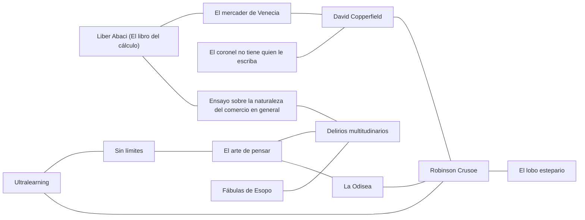

# Biblioteca

Libros que iluminan el currículo: novelas, fábulas, obras de teatro, tratados y divulgación. Cada libro tiene una **ficha** (`<slug>.md`) que dice de qué trata, qué temas toca, con qué otros libros se cruza y con qué nodos del currículo se conecta.

La biblioteca no reemplaza a los nodos: es la puerta para quien quiere ir más allá, y una fuente de ganchos e historias para quien escribe un nodo.

## Cómo agregar un libro

1. Copia `docs/plantillas/libro.md` a `biblioteca/<slug>.md`. El slug va en minúsculas y con guiones, sin artículos al inicio si no hacen falta.
2. Usa solo temas de [`_temas.yaml`](_temas.yaml). Si falta uno, agrégalo en el mismo PR.
3. En `cruza_con`, escribe **por qué** se cruzan los dos libros, en una frase. Cada cruce se declara una sola vez, en cualquiera de los dos libros; el índice lo muestra en ambos sentidos.
4. En `nodos`, pon solo ids que existan en algún `_modulo.yaml`.
5. Un libro nuevo entra con `estado: propuesta`. Pasa a `aceptado` cuando un curador lo revisa.
6. Corre `python3 scripts/biblioteca.py --indice` para validar y actualizar el índice de abajo.

## Reglas

- **Derechos de autor.** Si el libro tiene derechos (`acceso: con-derechos`), no se suben copias ni fragmentos largos. Se cuenta con palabras propias y se citan frases cortas. Solo los libros de dominio público llevan `texto_libre`, y el enlace debe ser a una edición legal (Gutenberg, Wikisource).
- **No inventes datos** (AGENTS.md, regla 5). Fechas, capítulos y escenas se comprueban; si no hay fuente, se deja `<!-- VERIFICAR: ... -->`.
- **Con cuidado.** Si el libro trae temas sensibles o prejuicios de su época, la ficha lo dice.

<!-- indice:inicio -->
<!-- Generado por scripts/biblioteca.py --indice. No editar a mano. -->

### Libros

| Libro | Autor | Publicado | Temas | Nodos | Estado |
| --- | --- | --- | --- | --- | --- |
| [*David Copperfield*](david-copperfield.md) 📖 | Charles Dickens | 1849-1850 | presupuesto, deuda, dignidad | `dinero.ingresos-y-gastos`, `dinero.presupuesto` | propuesta |
| [*Delirios multitudinarios*](delirios-multitudinarios.md) 📖 | Charles Mackay | 1841 | especulacion, codicia | `dinero.estafas-y-piramides`, `dinero.invertir-lo-basico`, `dinero.inflacion` | propuesta |
| [*El arte de pensar*](el-arte-de-pensar.md) | Rolf Dobelli | 2011 | sesgos, especulacion, autocontrol | `dinero.estafas-y-piramides`, `dinero.interes-compuesto`, `dinero.ahorro-y-metas`, `dinero.invertir-lo-basico` | propuesta |
| [*El coronel no tiene quien le escriba*](el-coronel-no-tiene-quien-le-escriba.md) | Gabriel García Márquez | 1961 | vejez-y-proteccion, dignidad | `dinero.primer-salario-y-seguridad-social` | propuesta |
| [*El lobo estepario*](el-lobo-estepario.md) | Hermann Hesse | 1927 | identidad, soledad | — | propuesta |
| [*El mercader de Venecia*](mercader-de-venecia.md) 📖 | William Shakespeare | hacia 1596-1598 | deuda, justicia, comercio | `dinero.deuda-buena-y-mala`, `dinero.costo-real-de-un-credito` | propuesta |
| [*Ensayo sobre la naturaleza del comercio en general*](ensayo-sobre-el-comercio.md) 📖 | Richard Cantillon | 1755 | emprendimiento, comercio, especulacion | `dinero.emprender-con-numeros`, `dinero.inflacion` | propuesta |
| [*Fábulas de Esopo*](fabulas-de-esopo.md) 📖 | Esopo (atribuidas) | s. VI a. C. (según la tradición) | ahorro, codicia | `dinero.ahorro-y-metas`, `dinero.invertir-lo-basico` | propuesta |
| [*La Odisea*](odisea.md) 📖 | Homero | s. VIII a. C. (según la tradición) | viaje, autocontrol | `dinero.ahorro-y-metas` | propuesta |
| [*Liber Abaci (El libro del cálculo)*](liber-abaci.md) | Leonardo de Pisa (Fibonacci) | 1202 | matematicas, comercio | `dinero.costo-real-de-un-credito` | propuesta |
| [*Robinson Crusoe*](robinson-crusoe.md) 📖 | Daniel Defoe | 1719 | necesidad-y-deseo, presupuesto, soledad, viaje | `dinero.necesidad-o-deseo`, `dinero.presupuesto` | propuesta |
| [*Sin límites*](limitless.md) | Jim Kwik | 2020 | aprender-a-aprender, sesgos | — | propuesta |
| [*Ultralearning*](ultralearning.md) | Scott H. Young | 2019 | aprender-a-aprender, autocontrol | — | propuesta |

📖 = texto completo libre y legal (dominio público).

### Cruces

| Libro | Se cruza con | Por qué |
| --- | --- | --- |
| [*David Copperfield*](david-copperfield.md) | [*Robinson Crusoe*](robinson-crusoe.md) | Dos maneras de llevar cuentas: la regla de Micawber y la lista de males y bienes de Robinson. |
| [*El arte de pensar*](el-arte-de-pensar.md) | [*Delirios multitudinarios*](delirios-multitudinarios.md) | Dobelli explica en un capítulo la prueba social; Mackay muestra a países enteros cayendo en ella. |
| [*El arte de pensar*](el-arte-de-pensar.md) | [*La Odisea*](odisea.md) | El descuento hiperbólico (preferir el premio de hoy) es el problema; atarse al mástil, una solución. |
| [*El coronel no tiene quien le escriba*](el-coronel-no-tiene-quien-le-escriba.md) | [*David Copperfield*](david-copperfield.md) | Pobreza con dignidad: el coronel y Micawber mantienen las apariencias aunque no tienen con qué. |
| [*El mercader de Venecia*](mercader-de-venecia.md) | [*David Copperfield*](david-copperfield.md) | Dos deudores: Antonio pone su propio cuerpo como garantía; Micawber termina en la cárcel por deudas. |
| [*Ensayo sobre la naturaleza del comercio en general*](ensayo-sobre-el-comercio.md) | [*Delirios multitudinarios*](delirios-multitudinarios.md) | Cantillon se hizo rico con la burbuja de John Law que cuenta Mackay, y vendió antes de que estallara. |
| [*Fábulas de Esopo*](fabulas-de-esopo.md) | [*Delirios multitudinarios*](delirios-multitudinarios.md) | La gallina de los huevos de oro en versión real: gente que lo arriesga todo por ganar más, y más rápido. |
| [*La Odisea*](odisea.md) | [*Robinson Crusoe*](robinson-crusoe.md) | Dos náufragos lejos de casa: Ulises sale adelante con astucia; Robinson, con trabajo y cuentas. |
| [*Liber Abaci (El libro del cálculo)*](liber-abaci.md) | [*El mercader de Venecia*](mercader-de-venecia.md) | Comerciantes italianos y préstamos: Fibonacci les enseñó a hacer las cuentas; Shakespeare mostró qué pasa cuando un préstamo sale mal. |
| [*Liber Abaci (El libro del cálculo)*](liber-abaci.md) | [*Ensayo sobre la naturaleza del comercio en general*](ensayo-sobre-el-comercio.md) | Dos libros escritos para comerciantes, con cinco siglos de distancia. |
| [*Robinson Crusoe*](robinson-crusoe.md) | [*El lobo estepario*](el-lobo-estepario.md) | Dos hombres solos: a Robinson la soledad se la impone un naufragio; Harry Haller la elige. |
| [*Sin límites*](limitless.md) | [*El arte de pensar*](el-arte-de-pensar.md) | Dobelli enseña a desconfiar de las buenas historias y de la autoridad; sirve para leer con cabeza fría cualquier libro que prometa cambiarte la vida, incluido este. |
| [*Ultralearning*](ultralearning.md) | [*Robinson Crusoe*](robinson-crusoe.md) | Aprender solo y haciendo: Robinson aprende a hornear pan y a hacer vasijas a punta de intentos fallidos. |
| [*Ultralearning*](ultralearning.md) | [*Sin límites*](limitless.md) | Dos promesas de aprender más rápido; compararlas es un buen ejercicio para separar lo que tiene evidencia de lo que solo se dice. |

### Por tema

Dos libros que comparten tema son un cruce posible aunque nadie lo haya escrito aún.

- **ahorro** (guardar hoy para mañana): [*Fábulas de Esopo*](fabulas-de-esopo.md)
- **aprender-a-aprender** (cómo se aprende mejor y qué promesas no tienen evidencia): [*Sin límites*](limitless.md), [*Ultralearning*](ultralearning.md)
- **autocontrol** (resistir una tentación con un plan): [*El arte de pensar*](el-arte-de-pensar.md), [*La Odisea*](odisea.md), [*Ultralearning*](ultralearning.md)
- **codicia** (querer más de lo que hace falta, y lo que eso cuesta): [*Delirios multitudinarios*](delirios-multitudinarios.md), [*Fábulas de Esopo*](fabulas-de-esopo.md)
- **comercio** (comprar, vender e intercambiar): [*El mercader de Venecia*](mercader-de-venecia.md), [*Ensayo sobre la naturaleza del comercio en general*](ensayo-sobre-el-comercio.md), [*Liber Abaci (El libro del cálculo)*](liber-abaci.md)
- **deuda** (deber dinero y lo que pasa si no se paga): [*David Copperfield*](david-copperfield.md), [*El mercader de Venecia*](mercader-de-venecia.md)
- **dignidad** (sostenerse cuando falta todo): [*David Copperfield*](david-copperfield.md), [*El coronel no tiene quien le escriba*](el-coronel-no-tiene-quien-le-escriba.md)
- **emprendimiento** (arriesgar para crear algo propio): [*Ensayo sobre la naturaleza del comercio en general*](ensayo-sobre-el-comercio.md)
- **especulacion** (comprar porque otros compran (burbujas y pirámides)): [*Delirios multitudinarios*](delirios-multitudinarios.md), [*El arte de pensar*](el-arte-de-pensar.md), [*Ensayo sobre la naturaleza del comercio en general*](ensayo-sobre-el-comercio.md)
- **identidad** (quién soy y de cuántas piezas estoy hecho): [*El lobo estepario*](el-lobo-estepario.md)
- **justicia** (qué es justo cuando alguien no puede cumplir): [*El mercader de Venecia*](mercader-de-venecia.md)
- **matematicas** (cuentas que cambiaron la historia): [*Liber Abaci (El libro del cálculo)*](liber-abaci.md)
- **necesidad-y-deseo** (lo que necesito frente a lo que quiero): [*Robinson Crusoe*](robinson-crusoe.md)
- **presupuesto** (lo que entra frente a lo que sale): [*David Copperfield*](david-copperfield.md), [*Robinson Crusoe*](robinson-crusoe.md)
- **sesgos** (errores de pensamiento que todos cometemos sin darnos cuenta): [*El arte de pensar*](el-arte-de-pensar.md), [*Sin límites*](limitless.md)
- **soledad** (estar solo, por elección o por fuerza): [*El lobo estepario*](el-lobo-estepario.md), [*Robinson Crusoe*](robinson-crusoe.md)
- **viaje** (salir de casa y volver distinto): [*La Odisea*](odisea.md), [*Robinson Crusoe*](robinson-crusoe.md)
- **vejez-y-proteccion** (de qué vivir cuando ya no se puede trabajar): [*El coronel no tiene quien le escriba*](el-coronel-no-tiene-quien-le-escriba.md)

### Mapa

<!-- indice:fin -->
