# Biblioteca

Libros que iluminan el currículo: novelas, fábulas, obras de teatro, tratados y divulgación. Cada libro tiene una **ficha** (`<slug>.md`) que dice de qué trata, qué temas toca, con qué otros libros se cruza y con qué nodos del currículo se conecta.

La biblioteca no reemplaza a los nodos: es la puerta para quien quiere ir más allá, y una fuente de ganchos e historias para quien escribe un nodo.

## Cómo agregar un libro

1. Copia `docs/plantillas/libro.md` a `biblioteca/<slug>.md`. El slug va en minúsculas y con guiones, sin artículos al inicio si no hacen falta.
2. Usa solo temas de [`_temas.yaml`](_temas.yaml). Si falta uno, agrégalo en el mismo PR.
3. En `cruza_con`, escribe **por qué** se cruzan los dos libros, en una frase. Cada cruce se declara una sola vez, en cualquiera de los dos libros; el índice lo muestra en ambos sentidos.
4. En `nodos`, pon solo ids que existan en algún `_modulo.yaml`.
5. En divulgación, ensayo, tratado y monografía, escribe también las secciones **Resumen** y **Análisis** de la plantilla: qué dice el libro y qué tan bien se sostiene. Mira *Ultralearning* o *El arte de pensar* como ejemplo.
6. Un libro nuevo entra con `estado: propuesta`. Pasa a `aceptado` cuando un curador lo revisa.
7. Corre `python3 scripts/biblioteca.py --indice` para validar y actualizar el índice de abajo.

¿No sabes qué libro agregar? Mira el backlog en [`_pendientes.md`](_pendientes.md).

## Reglas

- **Derechos de autor.** Si el libro tiene derechos (`acceso: con-derechos`), no se suben copias ni fragmentos largos. Se cuenta con palabras propias y se citan frases cortas. Solo los libros de dominio público llevan `texto_libre`, y el enlace debe ser a una edición legal (Gutenberg, Wikisource).
- **No inventes datos** (AGENTS.md, regla 5). Fechas, capítulos y escenas se comprueban; si no hay fuente, se deja `<!-- VERIFICAR: ... -->`.
- **Con cuidado.** Si el libro trae temas sensibles o prejuicios de su época, la ficha lo dice.

## Página pública de aprender a aprender

Los libros del tema *aprender a aprender* tienen una página para compartir con estudiantes, docentes y familias: veredicto de cada libro con el estudio que lo sostiene, mapa de cruces, un explicador animado, un juego de "¿mito o evidencia?", un planificador de repaso espaciado y una versión de cinco minutos en Formato Curioso.

```bash
python3 scripts/pagina_aprender.py   # escribe _sitio/aprender-a-aprender.html
```

- El texto de cada libro sale de su ficha: si corriges una ficha, vuelve a generar la página.
- Los veredictos, las rutas de lectura y los grupos están en [`_pagina-aprender.yaml`](_pagina-aprender.yaml). Un veredicto resume el **Análisis** de la ficha y cita su estudio, comprobado en Crossref.
- El diseño y la interacción están en `scripts/plantillas/pagina_aprender.html`.

<!-- indice:inicio -->
<!-- Generado por scripts/biblioteca.py --indice. No editar a mano. -->

### Libros

| Libro | Autor | Publicado | Temas | Nodos | Estado |
| --- | --- | --- | --- | --- | --- |
| [*21 lecciones para el siglo XXI*](21-lecciones-para-el-siglo-xxi.md) | Yuval Noah Harari | 2018 | tecnologia, educacion, ficcion | `dinero.trabajo-independiente` | propuesta |
| [*A More Beautiful Question*](a-more-beautiful-question.md) | Warren Berger | 2014 | curiosidad, educacion | — | propuesta |
| [*Algoritmos para la vida cotidiana*](algorithms-to-live-by.md) | Brian Christian y Tom Griffiths | 2016 | decisiones, matematicas, memoria | — | propuesta |
| [*Aprender a aprender*](learning-how-to-learn.md) | Barbara Oakley y Terrence Sejnowski, con Alistair McConville | 2018 | aprender-a-aprender, concentracion, memoria | — | propuesta |
| [*Apréndetelo*](make-it-stick.md) | Peter C. Brown, Henry L. Roediger III y Mark A. McDaniel | 2014 | aprender-a-aprender, memoria | — | propuesta |
| [*Comunicación no violenta*](comunicacion-no-violenta.md) | Marshall B. Rosenberg | 1999 | comunicacion, justicia | — | propuesta |
| [*Cosmos*](cosmos.md) | Carl Sagan | 1980 | ciencia, matematicas | — | propuesta |
| [*Cómo ser un estoico*](how-to-be-a-stoic.md) | Massimo Pigliucci | 2017 | emociones, autocontrol, sentido | — | propuesta |
| [*David Copperfield*](david-copperfield.md) 📖 | Charles Dickens | 1849-1850 | presupuesto, deuda, dignidad | `dinero.ingresos-y-gastos`, `dinero.presupuesto` | propuesta |
| [*Deberías hablar con alguien*](maybe-you-should-talk-to-someone.md) | Lori Gottlieb | 2019 | salud-mental, emociones, relaciones | — | propuesta |
| [*Delirios multitudinarios*](delirios-multitudinarios.md) 📖 | Charles Mackay | 1841 | especulacion, codicia | `dinero.estafas-y-piramides`, `dinero.invertir-lo-basico`, `dinero.inflacion` | propuesta |
| [*Design de vida*](designing-your-life.md) | Bill Burnett y Dave Evans | 2016 | vocacion, emprendimiento | `dinero.trabajo-independiente`, `dinero.emprender-con-numeros` | propuesta |
| [*El abordaje de la educación experiencial*](el-abordaje-de-la-educacion-experiencial.md) | Juan Felipe Builes Jaramillo | 2003 | educacion, aprender-a-aprender | — | propuesta |
| [*El arte de pensar*](el-arte-de-pensar.md) | Rolf Dobelli | 2011 | sesgos, especulacion, autocontrol, aprender-a-aprender | `dinero.estafas-y-piramides`, `dinero.interes-compuesto`, `dinero.ahorro-y-metas`, `dinero.invertir-lo-basico`, `dinero.costo-real-de-un-credito` | propuesta |
| [*El coronel no tiene quien le escriba*](el-coronel-no-tiene-quien-le-escriba.md) | Gabriel García Márquez | 1961 | vejez-y-proteccion, dignidad | `dinero.primer-salario-y-seguridad-social` | propuesta |
| [*El hombre en busca de sentido*](el-hombre-en-busca-de-sentido.md) | Viktor E. Frankl | 1946 | sentido, dignidad | — | propuesta |
| [*El lobo estepario*](el-lobo-estepario.md) | Hermann Hesse | 1927 | identidad, soledad | — | propuesta |
| [*El maestro ignorante*](el-maestro-ignorante.md) | Jacques Rancière | 1987 | educacion, aprender-a-aprender | — | propuesta |
| [*El mercader de Venecia*](mercader-de-venecia.md) 📖 | William Shakespeare | hacia 1596-1598 | deuda, justicia, comercio | `dinero.deuda-buena-y-mala`, `dinero.costo-real-de-un-credito` | propuesta |
| [*El método Lean Startup*](the-lean-startup.md) | Eric Ries | 2011 | emprendimiento, decisiones | `dinero.emprender-con-numeros`, `dinero.trabajo-independiente` | propuesta |
| [*El poder de los hábitos*](the-power-of-habit.md) | Charles Duhigg | 2012 | habitos, autocontrol, necesidad-y-deseo | `dinero.necesidad-o-deseo`, `dinero.ahorro-y-metas` | propuesta |
| [*El poder de ser vulnerable*](daring-greatly.md) | Brené Brown | 2012 | emociones, relaciones, educacion | — | propuesta |
| [*Emilio, o De la educación*](emilio.md) 📖 | Jean-Jacques Rousseau | 1762 | educacion, aprender-a-aprender | — | propuesta |
| [*Enfócate*](deep-work.md) | Cal Newport | 2016 | concentracion, aprender-a-aprender | — | propuesta |
| [*Ensayo sobre la naturaleza del comercio en general*](ensayo-sobre-el-comercio.md) 📖 | Richard Cantillon | 1755 | emprendimiento, comercio, especulacion | `dinero.emprender-con-numeros`, `dinero.inflacion` | propuesta |
| [*Fuera de serie*](outliers.md) | Malcolm Gladwell | 2008 | talento-y-practica, aprender-a-aprender | — | propuesta |
| [*Fábulas de Esopo*](fabulas-de-esopo.md) 📖 | Esopo (atribuidas) | s. VI a. C. (según la tradición) | ahorro, codicia | `dinero.ahorro-y-metas`, `dinero.invertir-lo-basico` | propuesta |
| [*Hablar con extraños*](talking-to-strangers.md) | Malcolm Gladwell | 2019 | sesgos, comunicacion | `dinero.estafas-y-piramides` | propuesta |
| [*Hábitos atómicos*](atomic-habits.md) | James Clear | 2018 | habitos, autocontrol, ahorro, aprender-a-aprender | `dinero.ahorro-y-metas`, `dinero.interes-compuesto` | propuesta |
| [*Inteligencia emocional*](inteligencia-emocional.md) | Daniel Goleman | 1995 | emociones, autocontrol, educacion | `dinero.ahorro-y-metas` | propuesta |
| [*La Odisea*](odisea.md) 📖 | Homero | s. VIII a. C. (según la tradición) | viaje, autocontrol | `dinero.ahorro-y-metas` | propuesta |
| [*La invención de todas las cosas*](la-invencion-de-todas-las-cosas.md) | Jorge Volpi | 2024 | ficcion, identidad, memoria | — | propuesta |
| [*La señal y el ruido*](the-signal-and-the-noise.md) | Nate Silver | 2012 | decisiones, matematicas, especulacion | `dinero.invertir-lo-basico`, `dinero.estafas-y-piramides` | propuesta |
| [*La vida secreta del cerebro*](how-emotions-are-made.md) | Lisa Feldman Barrett | 2017 | emociones, ciencia | — | propuesta |
| [*Liber Abaci (El libro del cálculo)*](liber-abaci.md) | Leonardo de Pisa (Fibonacci) | 1202 | matematicas, comercio | `dinero.costo-real-de-un-credito` | propuesta |
| [*Los 7 hábitos de la gente altamente efectiva*](los-7-habitos.md) | Stephen R. Covey | 1989 | habitos, decisiones, comunicacion | — | propuesta |
| [*Los desafíos de la memoria*](moonwalking-with-einstein.md) | Joshua Foer | 2011 | memoria, talento-y-practica, aprender-a-aprender | — | propuesta |
| [*Los innovadores*](the-innovators.md) | Walter Isaacson | 2014 | tecnologia, emprendimiento, matematicas | — | propuesta |
| [*Malcolm X: una autobiografía*](autobiografia-de-malcolm-x.md) | Malcolm X con Alex Haley | 1965 | identidad, justicia, educacion | — | propuesta |
| [*Martin Luther King Jr.: textos y discursos radicales*](the-radical-king.md) | Martin Luther King Jr. (edición de Cornel West) | 2015 | justicia, comunicacion | — | propuesta |
| [*Mindset, la actitud del éxito*](mindset.md) | Carol S. Dweck | 2006 | talento-y-practica, aprender-a-aprender, identidad | — | propuesta |
| [*Moneyball*](moneyball.md) | Michael Lewis | 2003 | decisiones, sesgos, talento-y-practica, presupuesto | `dinero.presupuesto` | propuesta |
| [*Número uno*](peak.md) | Anders Ericsson y Robert Pool | 2016 | talento-y-practica, aprender-a-aprender | — | propuesta |
| [*Pedagogía del oprimido*](pedagogia-del-oprimido.md) | Paulo Freire | 1970 | educacion, justicia, aprender-a-aprender | — | propuesta |
| [*Pensar rápido, pensar despacio*](pensar-rapido-pensar-despacio.md) | Daniel Kahneman | 2011 | sesgos, matematicas | `dinero.estafas-y-piramides`, `dinero.invertir-lo-basico`, `dinero.costo-real-de-un-credito`, `dinero.seguros` | propuesta |
| [*Pequeño cerdo capitalista*](pequeno-cerdo-capitalista.md) | Sofía Macías | 2011 | ahorro, presupuesto, deuda | `dinero.ingresos-y-gastos`, `dinero.presupuesto`, `dinero.ahorro-y-metas`, `dinero.deuda-buena-y-mala`, `dinero.tarjetas-de-credito`, `dinero.invertir-lo-basico` | propuesta |
| [*Por qué dormimos*](why-we-sleep.md) | Matthew Walker | 2017 | ciencia, memoria, habitos | — | propuesta |
| [*Portarse mal*](misbehaving.md) | Richard H. Thaler | 2015 | sesgos, presupuesto, ahorro | `dinero.presupuesto`, `dinero.ahorro-y-metas`, `dinero.necesidad-o-deseo`, `dinero.invertir-lo-basico` | propuesta |
| [*Robinson Crusoe*](robinson-crusoe.md) 📖 | Daniel Defoe | 1719 | necesidad-y-deseo, presupuesto, soledad, viaje | `dinero.necesidad-o-deseo`, `dinero.presupuesto` | propuesta |
| [*Sin límites*](limitless.md) | Jim Kwik | 2020 | aprender-a-aprender, sesgos | — | propuesta |
| [*Summerhill*](summerhill.md) | A. S. Neill | 1960 | educacion, aprender-a-aprender | — | propuesta |
| [*Ultralearning*](ultralearning.md) | Scott H. Young | 2019 | aprender-a-aprender, autocontrol | — | propuesta |
| [*Un pequeño empujón*](nudge.md) | Richard H. Thaler y Cass R. Sunstein | 2008 | sesgos, ahorro, habitos | `dinero.ahorro-y-metas`, `dinero.presupuesto`, `dinero.tarjetas-de-credito` | propuesta |
| [*Una buena vida*](the-good-life.md) | Robert Waldinger y Marc Schulz | 2023 | relaciones, necesidad-y-deseo, sentido | `dinero.necesidad-o-deseo` | propuesta |
| [*¡Bienvenidos al universo!*](welcome-to-the-universe.md) | Neil deGrasse Tyson, Michael A. Strauss y J. Richard Gott | 2016 | ciencia, matematicas | — | propuesta |

📖 = texto completo libre y legal (dominio público).

### Cruces

| Libro | Se cruza con | Por qué |
| --- | --- | --- |
| [*21 lecciones para el siglo XXI*](21-lecciones-para-el-siglo-xxi.md) | [*La invención de todas las cosas*](la-invencion-de-todas-las-cosas.md) | Los dos dicen que los humanos cooperamos gracias a ficciones compartidas; Volpi discute la versión de Harari. |
| [*21 lecciones para el siglo XXI*](21-lecciones-para-el-siglo-xxi.md) | [*La señal y el ruido*](the-signal-and-the-noise.md) | Harari pronostica el futuro del trabajo con mucha seguridad; Silver enseña a desconfiar de los pronósticos que no dan probabilidades. |
| [*21 lecciones para el siglo XXI*](21-lecciones-para-el-siglo-xxi.md) | [*Ultralearning*](ultralearning.md) | Si lo que se aprende hoy puede quedar obsoleto, saber aprender solo es la habilidad clave: Harari lo plantea, Young propone cómo. |
| [*A More Beautiful Question*](a-more-beautiful-question.md) | [*Design de vida*](designing-your-life.md) | Los dos vienen del pensamiento de diseño: entender el problema, imaginar opciones y probarlas. |
| [*A More Beautiful Question*](a-more-beautiful-question.md) | [*El maestro ignorante*](el-maestro-ignorante.md) | Jacotot no explicaba: preguntaba y dejaba que los estudiantes buscaran. Berger defiende lo mismo para cualquier edad. |
| [*A More Beautiful Question*](a-more-beautiful-question.md) | [*Pedagogía del oprimido*](pedagogia-del-oprimido.md) | Freire criticó la escuela que solo da respuestas; Berger muestra qué pasa cuando se enseña a preguntar. |
| [*Algoritmos para la vida cotidiana*](algorithms-to-live-by.md) | [*Enfócate*](deep-work.md) | Saltar de una tarea a otra tiene un costo: Newport lo llama residuo de atención; los informáticos, thrashing. |
| [*Algoritmos para la vida cotidiana*](algorithms-to-live-by.md) | [*Los desafíos de la memoria*](moonwalking-with-einstein.md) | Foer entrena la memoria para recordar más; Christian y Griffiths explican por qué olvidar también es útil. |
| [*Algoritmos para la vida cotidiana*](algorithms-to-live-by.md) | [*Pensar rápido, pensar despacio*](pensar-rapido-pensar-despacio.md) | Kahneman muestra cuánto nos equivocamos; Christian y Griffiths, que muchas veces decidimos razonablemente bien con lo poco que sabemos. |
| [*Aprender a aprender*](learning-how-to-learn.md) | [*Enfócate*](deep-work.md) | Dos maneras de concentrarse: bloques cortos de 25 minutos con descanso (Oakley) o bloques largos sin distracciones (Newport). |
| [*Apréndetelo*](make-it-stick.md) | [*Aprender a aprender*](learning-how-to-learn.md) | Las mismas ideas sobre cómo se aprende: una versión para adultos y otra para niños y adolescentes. |
| [*Apréndetelo*](make-it-stick.md) | [*Ultralearning*](ultralearning.md) | Apréndetelo es la ciencia detrás de dos principios de Ultralearning: recuperar y retener. |
| [*Comunicación no violenta*](comunicacion-no-violenta.md) | [*El arte de pensar*](el-arte-de-pensar.md) | Separar lo que pasó de lo que juzgamos: Rosenberg lo pide para hablar mejor; Dobelli muestra cuánto nos cuesta. |
| [*Comunicación no violenta*](comunicacion-no-violenta.md) | [*Pedagogía del oprimido*](pedagogia-del-oprimido.md) | Los dos ponen el diálogo en el centro: Freire para educar, Rosenberg para resolver conflictos. |
| [*Comunicación no violenta*](comunicacion-no-violenta.md) | [*Summerhill*](summerhill.md) | Resolver los conflictos sin castigos ni culpas: la asamblea de Neill y las cuatro preguntas de Rosenberg. |
| [*Cosmos*](cosmos.md) | [*La invención de todas las cosas*](la-invencion-de-todas-las-cosas.md) | Los dos empiezan en el big bang y cuentan la historia humana como una búsqueda de sentido: Sagan desde la ciencia, Volpi desde la ficción. |
| [*Cosmos*](cosmos.md) | [*Liber Abaci (El libro del cálculo)*](liber-abaci.md) | Historia de las matemáticas que cambiaron el mundo: Sagan cuenta a Eratóstenes y a Kepler; Fibonacci trajo los números que usamos hoy. |
| [*Cómo ser un estoico*](how-to-be-a-stoic.md) | [*El hombre en busca de sentido*](el-hombre-en-busca-de-sentido.md) | La libertad interior de Frankl es la idea estoica de que lo único que de verdad depende de nosotros es cómo respondemos. |
| [*Cómo ser un estoico*](how-to-be-a-stoic.md) | [*La vida secreta del cerebro*](how-emotions-are-made.md) | Epicteto decía que no nos perturban las cosas sino lo que pensamos de ellas; Barrett estudia cómo el cerebro interpreta lo que sentimos. |
| [*David Copperfield*](david-copperfield.md) | [*Robinson Crusoe*](robinson-crusoe.md) | Dos maneras de llevar cuentas: la regla de Micawber y la lista de males y bienes de Robinson. |
| [*Deberías hablar con alguien*](maybe-you-should-talk-to-someone.md) | [*Cómo ser un estoico*](how-to-be-a-stoic.md) | El estoicismo bien entendido no pide aguantar en silencio: Gottlieb muestra que hasta una terapeuta necesita pedir ayuda. |
| [*Deberías hablar con alguien*](maybe-you-should-talk-to-someone.md) | [*El hombre en busca de sentido*](el-hombre-en-busca-de-sentido.md) | Dos psicoterapeutas que escriben sobre su propio sufrimiento para hablar del de los demás. |
| [*Deberías hablar con alguien*](maybe-you-should-talk-to-someone.md) | [*Una buena vida*](the-good-life.md) | Waldinger dice que las relaciones sostienen una buena vida; Gottlieb muestra cómo una relación, la de terapia, ayuda a cambiar. |
| [*Design de vida*](designing-your-life.md) | [*La Odisea*](odisea.md) | Los autores llaman "planes Odisea" a imaginar tres caminos posibles para los próximos cinco años; Ulises tampoco volvió por la ruta que había planeado. |
| [*Design de vida*](designing-your-life.md) | [*Mindset, la actitud del éxito*](mindset.md) | Los dos ven el fracaso como parte del proceso: Dweck lo explica con la mentalidad de crecimiento; Burnett y Evans proponen anotar los fracasos para aprender de ellos. |
| [*El abordaje de la educación experiencial*](el-abordaje-de-la-educacion-experiencial.md) | [*Apréndetelo*](make-it-stick.md) | Coinciden en que vivir algo no basta para aprenderlo: hace falta reflexionar (Builes) o recuperar de memoria (Apréndetelo). |
| [*El abordaje de la educación experiencial*](el-abordaje-de-la-educacion-experiencial.md) | [*Emilio, o De la educación*](emilio.md) | Rousseau aparece entre las bases filosóficas de la educación experiencial: aprender de las cosas y no de los discursos. |
| [*El abordaje de la educación experiencial*](el-abordaje-de-la-educacion-experiencial.md) | [*Pedagogía del oprimido*](pedagogia-del-oprimido.md) | Los dos parten de John Dewey: Freire lo lleva a la alfabetización de adultos y la justicia social; Builes, a los talleres de aventura en grupo. |
| [*El arte de pensar*](el-arte-de-pensar.md) | [*Apréndetelo*](make-it-stick.md) | El exceso de confianza en versión de estudiante: releer da la ilusión de saber, y Apréndetelo muestra cómo comprobarlo. |
| [*El arte de pensar*](el-arte-de-pensar.md) | [*Delirios multitudinarios*](delirios-multitudinarios.md) | Dobelli explica en un capítulo la prueba social; Mackay muestra a países enteros cayendo en ella. |
| [*El arte de pensar*](el-arte-de-pensar.md) | [*Hábitos atómicos*](atomic-habits.md) | Dobelli dice que la fuerza de voluntad se agota; Clear propone no depender de ella y cambiar el entorno. |
| [*El arte de pensar*](el-arte-de-pensar.md) | [*La Odisea*](odisea.md) | El descuento hiperbólico (preferir el premio de hoy) es el problema; atarse al mástil, una solución. |
| [*El coronel no tiene quien le escriba*](el-coronel-no-tiene-quien-le-escriba.md) | [*David Copperfield*](david-copperfield.md) | Pobreza con dignidad: el coronel y Micawber mantienen las apariencias aunque no tienen con qué. |
| [*El hombre en busca de sentido*](el-hombre-en-busca-de-sentido.md) | [*El coronel no tiene quien le escriba*](el-coronel-no-tiene-quien-le-escriba.md) | Sostenerse cuando falta todo: el coronel espera una carta; Frankl, volver a ver a los suyos. |
| [*El hombre en busca de sentido*](el-hombre-en-busca-de-sentido.md) | [*Mindset, la actitud del éxito*](mindset.md) | Los dos dicen que la actitud cuenta, y los dos corren el riesgo de culpar a quien no pudo con circunstancias que no eligió. |
| [*El maestro ignorante*](el-maestro-ignorante.md) | [*Ultralearning*](ultralearning.md) | Aprender sin que nadie te explique: Jacotot en 1818 y Scott Young con los cursos abiertos del MIT. |
| [*El mercader de Venecia*](mercader-de-venecia.md) | [*David Copperfield*](david-copperfield.md) | Dos deudores: Antonio pone su propio cuerpo como garantía; Micawber termina en la cárcel por deudas. |
| [*El método Lean Startup*](the-lean-startup.md) | [*Design de vida*](designing-your-life.md) | La misma idea aplicada a cosas distintas: probar en pequeño antes de decidir, Ries con un negocio y Burnett y Evans con la propia vida. |
| [*El método Lean Startup*](the-lean-startup.md) | [*La señal y el ruido*](the-signal-and-the-noise.md) | Los dos piden tratar lo que creemos como una hipótesis y cambiar de opinión cuando los datos lo indican. |
| [*El método Lean Startup*](the-lean-startup.md) | [*Pequeño cerdo capitalista*](pequeno-cerdo-capitalista.md) | Macías enseña a cuidar el dinero propio; Ries, a no gastarlo en un negocio antes de saber si alguien lo quiere. |
| [*El poder de los hábitos*](the-power-of-habit.md) | [*Hábitos atómicos*](atomic-habits.md) | Clear construye su método sobre el bucle de Duhigg (señal, rutina, recompensa) y le agrega una cuarta pieza: el anhelo como paso propio. |
| [*El poder de los hábitos*](the-power-of-habit.md) | [*Un pequeño empujón*](nudge.md) | Las empresas también estudian nuestros hábitos para vendernos más: Duhigg lo muestra con Target; Thaler y Sunstein, con los empujones. |
| [*El poder de ser vulnerable*](daring-greatly.md) | [*Deberías hablar con alguien*](maybe-you-should-talk-to-someone.md) | Mostrarse vulnerable y pedir ayuda: Brown lo propone; Gottlieb lo muestra desde la consulta de una terapeuta. |
| [*El poder de ser vulnerable*](daring-greatly.md) | [*Inteligencia emocional*](inteligencia-emocional.md) | Dos éxitos de ventas sobre las emociones con una base científica más delgada de lo que su fama sugiere; útiles para enseñar a leer la evidencia. |
| [*El poder de ser vulnerable*](daring-greatly.md) | [*Mindset, la actitud del éxito*](mindset.md) | Atreverse a fallar: Dweck lo explica con la mentalidad de crecimiento; Brown, con la vergüenza que nos impide intentarlo. |
| [*Emilio, o De la educación*](emilio.md) | [*Pedagogía del oprimido*](pedagogia-del-oprimido.md) | Dos raíces de la educación activa, separadas por dos siglos: aprender de la experiencia (Rousseau) y del diálogo sobre la propia realidad (Freire). |
| [*Emilio, o De la educación*](emilio.md) | [*Robinson Crusoe*](robinson-crusoe.md) | Es el primer libro que Rousseau le deja leer a Emilio: el modelo de alguien que aprende de las cosas y no de los discursos. |
| [*Enfócate*](deep-work.md) | [*Ultralearning*](ultralearning.md) | La concentración es uno de los nueve principios de Ultralearning; Newport le dedica un libro entero. |
| [*Ensayo sobre la naturaleza del comercio en general*](ensayo-sobre-el-comercio.md) | [*Delirios multitudinarios*](delirios-multitudinarios.md) | Cantillon se hizo rico con la burbuja de John Law que cuenta Mackay, y vendió antes de que estallara. |
| [*Fábulas de Esopo*](fabulas-de-esopo.md) | [*Delirios multitudinarios*](delirios-multitudinarios.md) | La gallina de los huevos de oro en versión real: gente que lo arriesga todo por ganar más, y más rápido. |
| [*Hablar con extraños*](talking-to-strangers.md) | [*Fuera de serie*](outliers.md) | El mismo autor y el mismo método: historias muy bien contadas que a veces sostienen más de lo que prueban. |
| [*Hablar con extraños*](talking-to-strangers.md) | [*La vida secreta del cerebro*](how-emotions-are-made.md) | Gladwell llama "transparencia" al error de creer que la cara muestra lo que alguien siente; Barrett estudia por qué no es así. |
| [*Hábitos atómicos*](atomic-habits.md) | [*La Odisea*](odisea.md) | Diseñar el entorno para no caer en la tentación es la versión moderna de atarse al mástil. |
| [*Inteligencia emocional*](inteligencia-emocional.md) | [*Comunicación no violenta*](comunicacion-no-violenta.md) | Goleman dice que hay que reconocer las emociones propias y ajenas; Rosenberg da un método para nombrarlas en medio de un conflicto. |
| [*Inteligencia emocional*](inteligencia-emocional.md) | [*La Odisea*](odisea.md) | Ulises se ata al mástil porque sabe que no resistirá a las sirenas: autocontrol con un plan, no con fuerza de voluntad. |
| [*Inteligencia emocional*](inteligencia-emocional.md) | [*Mindset, la actitud del éxito*](mindset.md) | Dos ideas de psicología que se volvieron moda: tienen una base real, pero la versión popular promete más de lo que muestran los estudios. |
| [*La Odisea*](odisea.md) | [*Robinson Crusoe*](robinson-crusoe.md) | Dos náufragos lejos de casa: Ulises sale adelante con astucia; Robinson, con trabajo y cuentas. |
| [*La invención de todas las cosas*](la-invencion-de-todas-las-cosas.md) | [*Fábulas de Esopo*](fabulas-de-esopo.md) | Las fábulas son ficciones que enseñan a cooperar y a desconfiar: justo la función que Volpi le atribuye a la ficción. |
| [*La invención de todas las cosas*](la-invencion-de-todas-las-cosas.md) | [*La Odisea*](odisea.md) | Una de las ficciones más antiguas que seguimos contando; Volpi pregunta por qué los seres humanos no podemos dejar de contar historias. |
| [*La invención de todas las cosas*](la-invencion-de-todas-las-cosas.md) | [*Pensar rápido, pensar despacio*](pensar-rapido-pensar-despacio.md) | Volpi usa el cerebro rápido de Kahneman para explicar por qué creemos en las historias antes de pensarlas. |
| [*La señal y el ruido*](the-signal-and-the-noise.md) | [*Algoritmos para la vida cotidiana*](algorithms-to-live-by.md) | Los dos enseñan la regla de Bayes y el sobreajuste: actualizar lo que creemos con cada dato nuevo, sin confundir el ruido con la señal. |
| [*La señal y el ruido*](the-signal-and-the-noise.md) | [*Delirios multitudinarios*](delirios-multitudinarios.md) | Mackay cuenta las burbujas del siglo XVIII; Silver, la de 2008, y por qué casi nadie la vio venir. |
| [*La señal y el ruido*](the-signal-and-the-noise.md) | [*Pensar rápido, pensar despacio*](pensar-rapido-pensar-despacio.md) | Los expertos se equivocan con mucha confianza: Kahneman explica por qué; Silver muestra cómo pronosticar mejor. |
| [*La vida secreta del cerebro*](how-emotions-are-made.md) | [*Comunicación no violenta*](comunicacion-no-violenta.md) | Los dos piden nombrar con precisión lo que uno siente: Rosenberg para entenderse con otros; Barrett porque nombrar mejor ayuda a sentirse mejor. |
| [*La vida secreta del cerebro*](how-emotions-are-made.md) | [*Inteligencia emocional*](inteligencia-emocional.md) | Dos ideas opuestas de las emociones: Goleman las ve como reacciones que hay que manejar; Barrett, como algo que el cerebro construye y que se puede aprender a construir de otra forma. |
| [*Liber Abaci (El libro del cálculo)*](liber-abaci.md) | [*El mercader de Venecia*](mercader-de-venecia.md) | Comerciantes italianos y préstamos: Fibonacci les enseñó a hacer las cuentas; Shakespeare mostró qué pasa cuando un préstamo sale mal. |
| [*Liber Abaci (El libro del cálculo)*](liber-abaci.md) | [*Ensayo sobre la naturaleza del comercio en general*](ensayo-sobre-el-comercio.md) | Dos libros escritos para comerciantes, con cinco siglos de distancia. |
| [*Los 7 hábitos de la gente altamente efectiva*](los-7-habitos.md) | [*Comunicación no violenta*](comunicacion-no-violenta.md) | Buscar primero entender: Covey y Rosenberg ponen la escucha antes que la respuesta. |
| [*Los 7 hábitos de la gente altamente efectiva*](los-7-habitos.md) | [*El hombre en busca de sentido*](el-hombre-en-busca-de-sentido.md) | Covey atribuyó a Frankl la idea del espacio entre el estímulo y la respuesta, pero la frase no aparece en sus libros. |
| [*Los 7 hábitos de la gente altamente efectiva*](los-7-habitos.md) | [*El poder de los hábitos*](the-power-of-habit.md) | La palabra "hábito" en dos sentidos: Covey la usa para principios de carácter; Duhigg, para las rutinas automáticas que estudia la neurociencia. |
| [*Los desafíos de la memoria*](moonwalking-with-einstein.md) | [*Sin límites*](limitless.md) | El palacio de la memoria: Kwik lo enseña como técnica; Foer cuenta cómo lo aprendió y hasta dónde llega. |
| [*Los innovadores*](the-innovators.md) | [*Algoritmos para la vida cotidiana*](algorithms-to-live-by.md) | Isaacson cuenta quién inventó las computadoras; Christian y Griffiths, qué podemos aprender de cómo piensan. |
| [*Los innovadores*](the-innovators.md) | [*El método Lean Startup*](the-lean-startup.md) | Dos miradas a Silicon Valley: la historia de cómo se hizo la revolución digital y el método que salió de sus empresas. |
| [*Malcolm X: una autobiografía*](autobiografia-de-malcolm-x.md) | [*Martin Luther King Jr.: textos y discursos radicales*](the-radical-king.md) | Los dos grandes líderes negros de los años sesenta, que empezaron en orillas opuestas (la no violencia y la separación) y terminaron más cerca de lo que se cree. |
| [*Malcolm X: una autobiografía*](autobiografia-de-malcolm-x.md) | [*Pedagogía del oprimido*](pedagogia-del-oprimido.md) | Aprender a leer para entender la propia opresión: Malcolm X lo hizo solo en una cárcel; Freire lo convirtió en un método. |
| [*Malcolm X: una autobiografía*](autobiografia-de-malcolm-x.md) | [*Ultralearning*](ultralearning.md) | Uno de los autodidactas más famosos: copió el diccionario entero en la cárcel para aprender a leer y a escribir bien. |
| [*Martin Luther King Jr.: textos y discursos radicales*](the-radical-king.md) | [*Comunicación no violenta*](comunicacion-no-violenta.md) | La no violencia en dos escalas: Rosenberg la aplica a una conversación difícil; King, a la lucha de todo un pueblo. |
| [*Martin Luther King Jr.: textos y discursos radicales*](the-radical-king.md) | [*Pedagogía del oprimido*](pedagogia-del-oprimido.md) | Dos voces de los años sesenta contra la opresión: King desde la no violencia y la fe; Freire desde la educación. |
| [*Mindset, la actitud del éxito*](mindset.md) | [*Fuera de serie*](outliers.md) | Dweck mira lo que pasa dentro de la persona (su mentalidad); Gladwell, lo que pasa afuera (sus oportunidades). |
| [*Mindset, la actitud del éxito*](mindset.md) | [*Sin límites*](limitless.md) | Los dos dicen que las creencias sobre uno mismo limitan lo que aprendemos; Dweck tiene más estudios detrás, y aun así su efecto es pequeño. |
| [*Moneyball*](moneyball.md) | [*Fuera de serie*](outliers.md) | Los dos discuten cómo se reconoce el talento: Gladwell mira las oportunidades; Lewis, los errores de los que buscan jugadores. |
| [*Moneyball*](moneyball.md) | [*La señal y el ruido*](the-signal-and-the-noise.md) | Silver dedica un capítulo al béisbol: cuándo los datos le ganan al ojo del experto, y cuándo los dos se complementan. |
| [*Moneyball*](moneyball.md) | [*Portarse mal*](misbehaving.md) | Thaler y Sunstein reseñaron Moneyball como un caso de economía del comportamiento, y Thaler estudió el mismo error en el draft del fútbol americano. |
| [*Número uno*](peak.md) | [*Fuera de serie*](outliers.md) | La regla de las 10.000 horas: Gladwell la popularizó con el estudio de Ericsson, y Ericsson responde que no es eso lo que encontró. |
| [*Número uno*](peak.md) | [*Los desafíos de la memoria*](moonwalking-with-einstein.md) | Foer usa la práctica deliberada de Ericsson para salir de la "meseta" en la que dejó de mejorar su memoria. |
| [*Pedagogía del oprimido*](pedagogia-del-oprimido.md) | [*El maestro ignorante*](el-maestro-ignorante.md) | Dos críticas al maestro que solo "deposita" o "explica": Freire propone el diálogo; Rancière, la igualdad de las inteligencias. |
| [*Pensar rápido, pensar despacio*](pensar-rapido-pensar-despacio.md) | [*Delirios multitudinarios*](delirios-multitudinarios.md) | Las burbujas que cuenta Mackay son exceso de confianza y prueba social a escala de un país. |
| [*Pensar rápido, pensar despacio*](pensar-rapido-pensar-despacio.md) | [*El arte de pensar*](el-arte-de-pensar.md) | Dobelli enumera los errores de pensamiento; Kahneman explica de dónde salen, con la teoría de los dos sistemas. |
| [*Pensar rápido, pensar despacio*](pensar-rapido-pensar-despacio.md) | [*Un pequeño empujón*](nudge.md) | Kahneman describe cómo se equivoca la mente; Thaler y Sunstein, cómo diseñar las decisiones para que esos errores pesen menos. |
| [*Pequeño cerdo capitalista*](pequeno-cerdo-capitalista.md) | [*David Copperfield*](david-copperfield.md) | La regla de Micawber y el presupuesto de Macías dicen lo mismo con 160 años de distancia: gastar un poco menos de lo que entra. |
| [*Pequeño cerdo capitalista*](pequeno-cerdo-capitalista.md) | [*Fábulas de Esopo*](fabulas-de-esopo.md) | Los gastos hormiga y la hormiga de la fábula: dos maneras de explicar que lo pequeño, repetido, se vuelve grande. |
| [*Pequeño cerdo capitalista*](pequeno-cerdo-capitalista.md) | [*Hábitos atómicos*](atomic-habits.md) | Ahorrar como un hábito pequeño y automático, no como un esfuerzo heroico. |
| [*Por qué dormimos*](why-we-sleep.md) | [*Apréndetelo*](make-it-stick.md) | Dormir después de estudiar consolida lo aprendido: la otra mitad de las técnicas de estudio que propone Make It Stick. |
| [*Por qué dormimos*](why-we-sleep.md) | [*La señal y el ruido*](the-signal-and-the-noise.md) | Un buen caso para la lección de Silver: una gráfica a la que le quitaron un dato cambia lo que parece decir. |
| [*Portarse mal*](misbehaving.md) | [*Pensar rápido, pensar despacio*](pensar-rapido-pensar-despacio.md) | La misma historia vista desde dos lados: Kahneman desde la psicología, Thaler desde la economía. Trabajaron juntos. |
| [*Portarse mal*](misbehaving.md) | [*Pequeño cerdo capitalista*](pequeno-cerdo-capitalista.md) | Macías enseña a ver los gastos hormiga; Thaler explica por qué se escapan: no tratamos igual todo el dinero, depende del cajón mental donde lo ponemos. |
| [*Portarse mal*](misbehaving.md) | [*Un pequeño empujón*](nudge.md) | Misbehaving cuenta cómo nació la idea de los empujones y cómo llegó a los gobiernos. |
| [*Robinson Crusoe*](robinson-crusoe.md) | [*El lobo estepario*](el-lobo-estepario.md) | Dos hombres solos: a Robinson la soledad se la impone un naufragio; Harry Haller la elige. |
| [*Sin límites*](limitless.md) | [*El arte de pensar*](el-arte-de-pensar.md) | Dobelli enseña a desconfiar de las buenas historias y de la autoridad; sirve para leer con cabeza fría cualquier libro que prometa cambiarte la vida, incluido este. |
| [*Summerhill*](summerhill.md) | [*El abordaje de la educación experiencial*](el-abordaje-de-la-educacion-experiencial.md) | El "reto por opción" y las clases voluntarias de Summerhill comparten una idea: nadie aprende a la fuerza. |
| [*Summerhill*](summerhill.md) | [*El maestro ignorante*](el-maestro-ignorante.md) | Confiar en que el estudiante puede aprender por sí mismo: Jacotot sin explicar, Neill sin clases obligatorias. |
| [*Summerhill*](summerhill.md) | [*Emilio, o De la educación*](emilio.md) | Los dos parten de que el niño es bueno por naturaleza y aprende mejor en libertad; Neill llevó la idea a una escuela real. |
| [*Ultralearning*](ultralearning.md) | [*El arte de pensar*](el-arte-de-pensar.md) | Ultralearning se apoya en historias de gente que lo logró; Dobelli explica por qué eso puede ser sesgo de supervivencia. |
| [*Ultralearning*](ultralearning.md) | [*Robinson Crusoe*](robinson-crusoe.md) | Aprender solo y haciendo: Robinson aprende a hornear pan y a hacer vasijas a punta de intentos fallidos. |
| [*Ultralearning*](ultralearning.md) | [*Sin límites*](limitless.md) | Dos promesas de aprender más rápido; compararlas es un buen ejercicio para separar lo que tiene evidencia de lo que solo se dice. |
| [*Un pequeño empujón*](nudge.md) | [*Hábitos atómicos*](atomic-habits.md) | Los dos dicen que el entorno pesa más que la fuerza de voluntad: Clear lo aplica a uno mismo; Thaler y Sunstein, a quien diseña las opciones de otros. |
| [*Un pequeño empujón*](nudge.md) | [*La Odisea*](odisea.md) | Ahorrar Más Mañana es atarse al mástil: comprometerse hoy a ahorrar los aumentos de sueldo que vendrán. |
| [*Un pequeño empujón*](nudge.md) | [*Pequeño cerdo capitalista*](pequeno-cerdo-capitalista.md) | Ahorrar de forma automática, para no depender de acordarse ni de la fuerza de voluntad. |
| [*Una buena vida*](the-good-life.md) | [*Comunicación no violenta*](comunicacion-no-violenta.md) | Waldinger dice que las relaciones se cuidan como la salud; Rosenberg da una forma concreta de hacerlo cuando hay conflicto. |
| [*Una buena vida*](the-good-life.md) | [*El hombre en busca de sentido*](el-hombre-en-busca-de-sentido.md) | Frankl se sostuvo pensando en su esposa; 85 años de datos dicen que las relaciones son lo que más pesa en una buena vida. |
| [*Una buena vida*](the-good-life.md) | [*Pequeño cerdo capitalista*](pequeno-cerdo-capitalista.md) | El dinero sí importa para estar bien, pero no reemplaza a los amigos: un buen par para el nodo Necesidad o deseo. |
| [*¡Bienvenidos al universo!*](welcome-to-the-universe.md) | [*Cosmos*](cosmos.md) | Dos generaciones de divulgación del universo: Sagan cuenta la historia y el asombro; Tyson, Strauss y Gott, la física con números. |

### Por tema

Dos libros que comparten tema son un cruce posible aunque nadie lo haya escrito aún.

- **ahorro** (guardar hoy para mañana): [*Fábulas de Esopo*](fabulas-de-esopo.md), [*Hábitos atómicos*](atomic-habits.md), [*Pequeño cerdo capitalista*](pequeno-cerdo-capitalista.md), [*Portarse mal*](misbehaving.md), [*Un pequeño empujón*](nudge.md)
- **aprender-a-aprender** (cómo se aprende mejor y qué promesas no tienen evidencia): [*Aprender a aprender*](learning-how-to-learn.md), [*Apréndetelo*](make-it-stick.md), [*El abordaje de la educación experiencial*](el-abordaje-de-la-educacion-experiencial.md), [*El arte de pensar*](el-arte-de-pensar.md), [*El maestro ignorante*](el-maestro-ignorante.md), [*Emilio, o De la educación*](emilio.md), [*Enfócate*](deep-work.md), [*Fuera de serie*](outliers.md), [*Hábitos atómicos*](atomic-habits.md), [*Los desafíos de la memoria*](moonwalking-with-einstein.md), [*Mindset, la actitud del éxito*](mindset.md), [*Número uno*](peak.md), [*Pedagogía del oprimido*](pedagogia-del-oprimido.md), [*Sin límites*](limitless.md), [*Summerhill*](summerhill.md), [*Ultralearning*](ultralearning.md)
- **autocontrol** (resistir una tentación con un plan): [*Cómo ser un estoico*](how-to-be-a-stoic.md), [*El arte de pensar*](el-arte-de-pensar.md), [*El poder de los hábitos*](the-power-of-habit.md), [*Hábitos atómicos*](atomic-habits.md), [*Inteligencia emocional*](inteligencia-emocional.md), [*La Odisea*](odisea.md), [*Ultralearning*](ultralearning.md)
- **ciencia** (cómo sabemos lo que sabemos, y cómo se corrige): [*Cosmos*](cosmos.md), [*La vida secreta del cerebro*](how-emotions-are-made.md), [*Por qué dormimos*](why-we-sleep.md), [*¡Bienvenidos al universo!*](welcome-to-the-universe.md)
- **codicia** (querer más de lo que hace falta, y lo que eso cuesta): [*Delirios multitudinarios*](delirios-multitudinarios.md), [*Fábulas de Esopo*](fabulas-de-esopo.md)
- **comercio** (comprar, vender e intercambiar): [*El mercader de Venecia*](mercader-de-venecia.md), [*Ensayo sobre la naturaleza del comercio en general*](ensayo-sobre-el-comercio.md), [*Liber Abaci (El libro del cálculo)*](liber-abaci.md)
- **comunicacion** (hablar y escuchar para entenderse, también en un conflicto): [*Comunicación no violenta*](comunicacion-no-violenta.md), [*Hablar con extraños*](talking-to-strangers.md), [*Los 7 hábitos de la gente altamente efectiva*](los-7-habitos.md), [*Martin Luther King Jr.: textos y discursos radicales*](the-radical-king.md)
- **concentracion** (prestar atención a una sola cosa sin distraerse): [*Aprender a aprender*](learning-how-to-learn.md), [*Enfócate*](deep-work.md)
- **curiosidad** (hacerse preguntas y querer saber): [*A More Beautiful Question*](a-more-beautiful-question.md)
- **decisiones** (elegir bien cuando no se sabe todo): [*Algoritmos para la vida cotidiana*](algorithms-to-live-by.md), [*El método Lean Startup*](the-lean-startup.md), [*La señal y el ruido*](the-signal-and-the-noise.md), [*Los 7 hábitos de la gente altamente efectiva*](los-7-habitos.md), [*Moneyball*](moneyball.md)
- **deuda** (deber dinero y lo que pasa si no se paga): [*David Copperfield*](david-copperfield.md), [*El mercader de Venecia*](mercader-de-venecia.md), [*Pequeño cerdo capitalista*](pequeno-cerdo-capitalista.md)
- **dignidad** (sostenerse cuando falta todo): [*David Copperfield*](david-copperfield.md), [*El coronel no tiene quien le escriba*](el-coronel-no-tiene-quien-le-escriba.md), [*El hombre en busca de sentido*](el-hombre-en-busca-de-sentido.md)
- **educacion** (qué es enseñar, quién enseña y para qué se aprende): [*21 lecciones para el siglo XXI*](21-lecciones-para-el-siglo-xxi.md), [*A More Beautiful Question*](a-more-beautiful-question.md), [*El abordaje de la educación experiencial*](el-abordaje-de-la-educacion-experiencial.md), [*El maestro ignorante*](el-maestro-ignorante.md), [*El poder de ser vulnerable*](daring-greatly.md), [*Emilio, o De la educación*](emilio.md), [*Inteligencia emocional*](inteligencia-emocional.md), [*Malcolm X: una autobiografía*](autobiografia-de-malcolm-x.md), [*Pedagogía del oprimido*](pedagogia-del-oprimido.md), [*Summerhill*](summerhill.md)
- **emociones** (reconocer lo que sentimos y qué hacer con ello): [*Cómo ser un estoico*](how-to-be-a-stoic.md), [*Deberías hablar con alguien*](maybe-you-should-talk-to-someone.md), [*El poder de ser vulnerable*](daring-greatly.md), [*Inteligencia emocional*](inteligencia-emocional.md), [*La vida secreta del cerebro*](how-emotions-are-made.md)
- **emprendimiento** (arriesgar para crear algo propio): [*Design de vida*](designing-your-life.md), [*El método Lean Startup*](the-lean-startup.md), [*Ensayo sobre la naturaleza del comercio en general*](ensayo-sobre-el-comercio.md), [*Los innovadores*](the-innovators.md)
- **especulacion** (comprar porque otros compran (burbujas y pirámides)): [*Delirios multitudinarios*](delirios-multitudinarios.md), [*El arte de pensar*](el-arte-de-pensar.md), [*Ensayo sobre la naturaleza del comercio en general*](ensayo-sobre-el-comercio.md), [*La señal y el ruido*](the-signal-and-the-noise.md)
- **ficcion** (las historias que nos contamos y para qué nos sirven): [*21 lecciones para el siglo XXI*](21-lecciones-para-el-siglo-xxi.md), [*La invención de todas las cosas*](la-invencion-de-todas-las-cosas.md)
- **habitos** (lo que hacemos sin pensar y cómo se cambia): [*El poder de los hábitos*](the-power-of-habit.md), [*Hábitos atómicos*](atomic-habits.md), [*Los 7 hábitos de la gente altamente efectiva*](los-7-habitos.md), [*Por qué dormimos*](why-we-sleep.md), [*Un pequeño empujón*](nudge.md)
- **identidad** (quién soy y de cuántas piezas estoy hecho): [*El lobo estepario*](el-lobo-estepario.md), [*La invención de todas las cosas*](la-invencion-de-todas-las-cosas.md), [*Malcolm X: una autobiografía*](autobiografia-de-malcolm-x.md), [*Mindset, la actitud del éxito*](mindset.md)
- **justicia** (qué es justo cuando alguien no puede cumplir): [*Comunicación no violenta*](comunicacion-no-violenta.md), [*El mercader de Venecia*](mercader-de-venecia.md), [*Malcolm X: una autobiografía*](autobiografia-de-malcolm-x.md), [*Martin Luther King Jr.: textos y discursos radicales*](the-radical-king.md), [*Pedagogía del oprimido*](pedagogia-del-oprimido.md)
- **matematicas** (cuentas que cambiaron la historia): [*Algoritmos para la vida cotidiana*](algorithms-to-live-by.md), [*Cosmos*](cosmos.md), [*La señal y el ruido*](the-signal-and-the-noise.md), [*Liber Abaci (El libro del cálculo)*](liber-abaci.md), [*Los innovadores*](the-innovators.md), [*Pensar rápido, pensar despacio*](pensar-rapido-pensar-despacio.md), [*¡Bienvenidos al universo!*](welcome-to-the-universe.md)
- **memoria** (cómo recordamos y cómo se entrena): [*Algoritmos para la vida cotidiana*](algorithms-to-live-by.md), [*Aprender a aprender*](learning-how-to-learn.md), [*Apréndetelo*](make-it-stick.md), [*La invención de todas las cosas*](la-invencion-de-todas-las-cosas.md), [*Los desafíos de la memoria*](moonwalking-with-einstein.md), [*Por qué dormimos*](why-we-sleep.md)
- **necesidad-y-deseo** (lo que necesito frente a lo que quiero): [*El poder de los hábitos*](the-power-of-habit.md), [*Robinson Crusoe*](robinson-crusoe.md), [*Una buena vida*](the-good-life.md)
- **presupuesto** (lo que entra frente a lo que sale): [*David Copperfield*](david-copperfield.md), [*Moneyball*](moneyball.md), [*Pequeño cerdo capitalista*](pequeno-cerdo-capitalista.md), [*Portarse mal*](misbehaving.md), [*Robinson Crusoe*](robinson-crusoe.md)
- **relaciones** (amigos, familia y pareja, y cuánto pesan en una buena vida): [*Deberías hablar con alguien*](maybe-you-should-talk-to-someone.md), [*El poder de ser vulnerable*](daring-greatly.md), [*Una buena vida*](the-good-life.md)
- **salud-mental** (cuidar la mente y saber pedir ayuda): [*Deberías hablar con alguien*](maybe-you-should-talk-to-someone.md)
- **sentido** (para qué vivir, también cuando las cosas van mal): [*Cómo ser un estoico*](how-to-be-a-stoic.md), [*El hombre en busca de sentido*](el-hombre-en-busca-de-sentido.md), [*Una buena vida*](the-good-life.md)
- **sesgos** (errores de pensamiento que todos cometemos sin darnos cuenta): [*El arte de pensar*](el-arte-de-pensar.md), [*Hablar con extraños*](talking-to-strangers.md), [*Moneyball*](moneyball.md), [*Pensar rápido, pensar despacio*](pensar-rapido-pensar-despacio.md), [*Portarse mal*](misbehaving.md), [*Sin límites*](limitless.md), [*Un pequeño empujón*](nudge.md)
- **soledad** (estar solo, por elección o por fuerza): [*El lobo estepario*](el-lobo-estepario.md), [*Robinson Crusoe*](robinson-crusoe.md)
- **talento-y-practica** (cuánto pesa lo innato y cuánto la práctica): [*Fuera de serie*](outliers.md), [*Los desafíos de la memoria*](moonwalking-with-einstein.md), [*Mindset, la actitud del éxito*](mindset.md), [*Moneyball*](moneyball.md), [*Número uno*](peak.md)
- **tecnologia** (cómo las máquinas cambian el trabajo y la vida, y quién las inventa): [*21 lecciones para el siglo XXI*](21-lecciones-para-el-siglo-xxi.md), [*Los innovadores*](the-innovators.md)
- **vejez-y-proteccion** (de qué vivir cuando ya no se puede trabajar): [*El coronel no tiene quien le escriba*](el-coronel-no-tiene-quien-le-escriba.md)
- **viaje** (salir de casa y volver distinto): [*La Odisea*](odisea.md), [*Robinson Crusoe*](robinson-crusoe.md)
- **vocacion** (qué hacer con la vida y con el trabajo): [*Design de vida*](designing-your-life.md)

### Mapa

```mermaid
flowchart LR
  21_lecciones_para_el_siglo_xxi["21 lecciones para el siglo XXI"]
  a_more_beautiful_question["A More Beautiful Question"]
  algorithms_to_live_by["Algoritmos para la vida cotidiana"]
  learning_how_to_learn["Aprender a aprender"]
  make_it_stick["Apréndetelo"]
  comunicacion_no_violenta["Comunicación no violenta"]
  cosmos["Cosmos"]
  how_to_be_a_stoic["Cómo ser un estoico"]
  david_copperfield["David Copperfield"]
  maybe_you_should_talk_to_someone["Deberías hablar con alguien"]
  delirios_multitudinarios["Delirios multitudinarios"]
  designing_your_life["Design de vida"]
  el_abordaje_de_la_educacion_experiencial["El abordaje de la educación experiencial"]
  el_arte_de_pensar["El arte de pensar"]
  el_coronel_no_tiene_quien_le_escriba["El coronel no tiene quien le escriba"]
  el_hombre_en_busca_de_sentido["El hombre en busca de sentido"]
  el_lobo_estepario["El lobo estepario"]
  el_maestro_ignorante["El maestro ignorante"]
  mercader_de_venecia["El mercader de Venecia"]
  the_lean_startup["El método Lean Startup"]
  the_power_of_habit["El poder de los hábitos"]
  daring_greatly["El poder de ser vulnerable"]
  emilio["Emilio, o De la educación"]
  deep_work["Enfócate"]
  ensayo_sobre_el_comercio["Ensayo sobre la naturaleza del comercio en general"]
  outliers["Fuera de serie"]
  fabulas_de_esopo["Fábulas de Esopo"]
  talking_to_strangers["Hablar con extraños"]
  atomic_habits["Hábitos atómicos"]
  inteligencia_emocional["Inteligencia emocional"]
  odisea["La Odisea"]
  la_invencion_de_todas_las_cosas["La invención de todas las cosas"]
  the_signal_and_the_noise["La señal y el ruido"]
  how_emotions_are_made["La vida secreta del cerebro"]
  liber_abaci["Liber Abaci (El libro del cálculo)"]
  los_7_habitos["Los 7 hábitos de la gente altamente efectiva"]
  moonwalking_with_einstein["Los desafíos de la memoria"]
  the_innovators["Los innovadores"]
  autobiografia_de_malcolm_x["Malcolm X: una autobiografía"]
  the_radical_king["Martin Luther King Jr.: textos y discursos radicales"]
  mindset["Mindset, la actitud del éxito"]
  moneyball["Moneyball"]
  peak["Número uno"]
  pedagogia_del_oprimido["Pedagogía del oprimido"]
  pensar_rapido_pensar_despacio["Pensar rápido, pensar despacio"]
  pequeno_cerdo_capitalista["Pequeño cerdo capitalista"]
  why_we_sleep["Por qué dormimos"]
  misbehaving["Portarse mal"]
  robinson_crusoe["Robinson Crusoe"]
  limitless["Sin límites"]
  summerhill["Summerhill"]
  ultralearning["Ultralearning"]
  nudge["Un pequeño empujón"]
  the_good_life["Una buena vida"]
  welcome_to_the_universe["¡Bienvenidos al universo!"]
  21_lecciones_para_el_siglo_xxi --- la_invencion_de_todas_las_cosas
  21_lecciones_para_el_siglo_xxi --- the_signal_and_the_noise
  21_lecciones_para_el_siglo_xxi --- ultralearning
  a_more_beautiful_question --- pedagogia_del_oprimido
  a_more_beautiful_question --- el_maestro_ignorante
  a_more_beautiful_question --- designing_your_life
  algorithms_to_live_by --- pensar_rapido_pensar_despacio
  algorithms_to_live_by --- deep_work
  algorithms_to_live_by --- moonwalking_with_einstein
  atomic_habits --- odisea
  autobiografia_de_malcolm_x --- the_radical_king
  autobiografia_de_malcolm_x --- pedagogia_del_oprimido
  autobiografia_de_malcolm_x --- ultralearning
  comunicacion_no_violenta --- pedagogia_del_oprimido
  comunicacion_no_violenta --- summerhill
  comunicacion_no_violenta --- el_arte_de_pensar
  cosmos --- la_invencion_de_todas_las_cosas
  cosmos --- liber_abaci
  daring_greatly --- inteligencia_emocional
  daring_greatly --- mindset
  daring_greatly --- maybe_you_should_talk_to_someone
  david_copperfield --- robinson_crusoe
  deep_work --- ultralearning
  designing_your_life --- odisea
  designing_your_life --- mindset
  el_abordaje_de_la_educacion_experiencial --- emilio
  el_abordaje_de_la_educacion_experiencial --- pedagogia_del_oprimido
  el_abordaje_de_la_educacion_experiencial --- make_it_stick
  el_arte_de_pensar --- delirios_multitudinarios
  el_arte_de_pensar --- odisea
  el_arte_de_pensar --- make_it_stick
  el_arte_de_pensar --- atomic_habits
  el_coronel_no_tiene_quien_le_escriba --- david_copperfield
  el_hombre_en_busca_de_sentido --- el_coronel_no_tiene_quien_le_escriba
  el_hombre_en_busca_de_sentido --- mindset
  el_maestro_ignorante --- ultralearning
  emilio --- robinson_crusoe
  emilio --- pedagogia_del_oprimido
  ensayo_sobre_el_comercio --- delirios_multitudinarios
  fabulas_de_esopo --- delirios_multitudinarios
  how_emotions_are_made --- inteligencia_emocional
  how_emotions_are_made --- comunicacion_no_violenta
  how_to_be_a_stoic --- el_hombre_en_busca_de_sentido
  how_to_be_a_stoic --- how_emotions_are_made
  inteligencia_emocional --- comunicacion_no_violenta
  inteligencia_emocional --- mindset
  inteligencia_emocional --- odisea
  la_invencion_de_todas_las_cosas --- odisea
  la_invencion_de_todas_las_cosas --- fabulas_de_esopo
  la_invencion_de_todas_las_cosas --- pensar_rapido_pensar_despacio
  learning_how_to_learn --- deep_work
  liber_abaci --- mercader_de_venecia
  liber_abaci --- ensayo_sobre_el_comercio
  limitless --- el_arte_de_pensar
  los_7_habitos --- the_power_of_habit
  los_7_habitos --- el_hombre_en_busca_de_sentido
  los_7_habitos --- comunicacion_no_violenta
  make_it_stick --- ultralearning
  make_it_stick --- learning_how_to_learn
  maybe_you_should_talk_to_someone --- how_to_be_a_stoic
  maybe_you_should_talk_to_someone --- the_good_life
  maybe_you_should_talk_to_someone --- el_hombre_en_busca_de_sentido
  mercader_de_venecia --- david_copperfield
  mindset --- limitless
  mindset --- outliers
  misbehaving --- pensar_rapido_pensar_despacio
  misbehaving --- nudge
  misbehaving --- pequeno_cerdo_capitalista
  moneyball --- misbehaving
  moneyball --- the_signal_and_the_noise
  moneyball --- outliers
  moonwalking_with_einstein --- limitless
  nudge --- atomic_habits
  nudge --- odisea
  nudge --- pequeno_cerdo_capitalista
  odisea --- robinson_crusoe
  peak --- outliers
  peak --- moonwalking_with_einstein
  pedagogia_del_oprimido --- el_maestro_ignorante
  pensar_rapido_pensar_despacio --- el_arte_de_pensar
  pensar_rapido_pensar_despacio --- nudge
  pensar_rapido_pensar_despacio --- delirios_multitudinarios
  pequeno_cerdo_capitalista --- fabulas_de_esopo
  pequeno_cerdo_capitalista --- david_copperfield
  pequeno_cerdo_capitalista --- atomic_habits
  robinson_crusoe --- el_lobo_estepario
  summerhill --- emilio
  summerhill --- el_maestro_ignorante
  summerhill --- el_abordaje_de_la_educacion_experiencial
  talking_to_strangers --- outliers
  talking_to_strangers --- how_emotions_are_made
  the_good_life --- el_hombre_en_busca_de_sentido
  the_good_life --- comunicacion_no_violenta
  the_good_life --- pequeno_cerdo_capitalista
  the_innovators --- algorithms_to_live_by
  the_innovators --- the_lean_startup
  the_lean_startup --- designing_your_life
  the_lean_startup --- the_signal_and_the_noise
  the_lean_startup --- pequeno_cerdo_capitalista
  the_power_of_habit --- atomic_habits
  the_power_of_habit --- nudge
  the_radical_king --- pedagogia_del_oprimido
  the_radical_king --- comunicacion_no_violenta
  the_signal_and_the_noise --- algorithms_to_live_by
  the_signal_and_the_noise --- delirios_multitudinarios
  the_signal_and_the_noise --- pensar_rapido_pensar_despacio
  ultralearning --- limitless
  ultralearning --- el_arte_de_pensar
  ultralearning --- robinson_crusoe
  welcome_to_the_universe --- cosmos
  why_we_sleep --- make_it_stick
  why_we_sleep --- the_signal_and_the_noise
```



<!-- indice:fin -->
