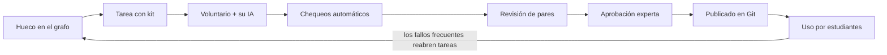

# Visión

## Qué es

New Old School es un colegio virtual open source que enseña primero lo que casi ningún colegio enseña y la vida práctica exige: dinero, derechos, salud, autonomía, pensamiento crítico. El nombre junta lo viejo (saberes que antes se aprendían en casa o en el oficio) con lo nuevo (IA, comunidad abierta, acceso global).

## Problema

Los sistemas escolares cubren contenidos académicos con resultados desiguales, y casi ninguno prepara para decisiones reales: un crédito, un contrato, una emergencia, una noticia falsa. En Colombia, según PISA 2025, solo el 29 % de los jóvenes de 15 años alcanza el nivel básico en matemáticas (65 % en la OCDE).

## Propuesta

Un currículo abierto, construido por voluntarios que donan su tiempo y su IA, revisado por docentes, que llega a cualquier estudiante incluso sin internet. Lo práctico es la puerta de entrada a lo académico.

## Qué no es

- No reemplaza al colegio ni compite con Khan Academy.
- No es un generador automático de contenido sin revisión humana.
- No es una plataforma cerrada ni con fines de lucro sobre el contenido.
- No da consejos personalizados (financieros, médicos o legales): enseña a entender y decidir.

## Principios de diseño

1. **Pocas grandes ideas a profundidad**, no listas interminables de temas.
2. **Conocimiento + prácticas**: saber qué es algo y saber hacerlo, investigarlo y argumentarlo.
3. **Dominio antes de avanzar**, con progresión en espiral y prerrequisitos explícitos.
4. **Lo práctico como puerta a lo académico**: cada nodo práctico conecta con los conceptos que lo sostienen.
5. **Enseñar cómo sabemos lo que sabemos**: evidencia, probabilidad, sesgos, hecho vs. opinión.
6. **Núcleo universal + adaptación local**: el concepto es común; cómo funciona aquí lo define cada comunidad.
7. **Pluralidad de perspectivas**, incluidos saberes locales e indígenas, con el mismo rigor crítico.
8. **Acceso como parte del diseño**: offline primero, celular básico, multilingüe, accesible.

## Modelo pedagógico

Cada unidad es un **hilo** alrededor de una gran pregunta. Varios expertos aportan piezas cortas; un **docente ancla** da continuidad; un **curador** diseña el hilo y sus puentes. Se aprende con práctica de recuperación, repaso espaciado, ejemplos resueltos, dominio antes de avanzar, proyectos con problemas reales del entorno y estudiantes que tutorean a otros. Un tutor con IA socrático (guía, no da respuestas) se integrará más adelante.

**Reglas para que un hilo no se fragmente:** un hilo conductor (no una colección de charlas), puentes explícitos al inicio y cierre de cada pieza, glosario común, y un proyecto integrador que exige todas las piezas.

## La plataforma (resumen)

Voluntarios toman microtareas de una cola (generar ejercicios, explicar en otro nivel, traducir, revisar), las resuelven con **su propia IA**, y lo que aprueban pares y expertos se publica en este repositorio.

No se "donan tokens": los límites de una suscripción personal no son transferibles y agruparlas suele violar los términos de los proveedores. Cada persona usa su IA en una tarea compartida, como en Wikipedia.

## Por qué empezamos por Dinero

Todos lo necesitan, casi nadie lo enseña, es fácil de evaluar con casos, tiene bajo riesgo si algo sale imperfecto, y conecta directamente con matemáticas.

## Documentos relacionados

- [Marco curricular](marco-curricular.md) · [Glosario](glosario.md) · [Hoja de ruta](roadmap.md) · [Equipo](equipo.md)
